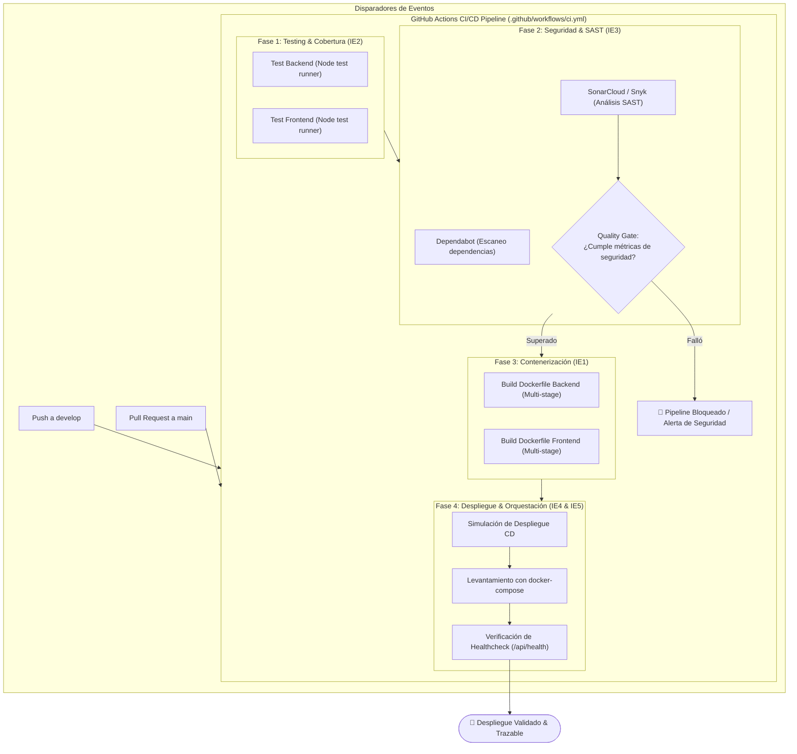

# Microservicio DevOps — Evaluación Parcial N°2: Añadiéndole Complejidad a Nuestro Pipeline

> **Asignatura:** DOY0101 - Ingeniería DevOps  
> **Institución:** Duoc UC  
> **Evaluación:** Evaluación Parcial 2 (45% ponderación)  
> **Estado:** Base técnica configurada y lista para despliegue de pipeline CI/CD

[](https://sonarcloud.io/summary/new_code?id=iTzAsaro_prueba-devops2)
[](https://sonarcloud.io/summary/new_code?id=iTzAsaro_prueba-devops2)
[](https://sonarcloud.io/summary/new_code?id=iTzAsaro_prueba-devops2)

---

## 👥 Equipo de Trabajo y Roles

| Integrante | Rol en el Proyecto | Responsabilidad Principal en EP2 | Indicadores de Evaluación |
| :--- | :--- | :--- | :--- |
| **Alexsander Rosales** | **Tech Lead & Security / CI Pipeline Core** | Orquestación del pipeline GitHub Actions, configuración de Dependabot, integración de análisis SAST (SonarCloud/Snyk), Quality Gates de bloqueo estricto y revisión de PRs. | **IE3 (Seguridad & Calidad)** |
| **Kevin** | **Container & Testing Automation Engineer** | Optimización de `Dockerfile` con Multi-Stage builds, usuario no privilegiado (`USER node`), `.dockerignore`, suite de pruebas unitarias y reportes de cobertura en CI. | **IE1 (Docker) & IE2 (Testing)** |
| **Paulo Rivas** | **DevOps & Orchestration Engineer** | Orquestación con `docker-compose.yml` (redes dedicadas, volúmenes, healthchecks), job de despliegue continuo (CD) en entorno simulado con trazabilidad y documentación técnica. | **IE4 (Despliegue) & IE5 (Orquestación)** |

---

## 🎯 Propósito del Proyecto (EP2)

El encargo de la **Evaluación Parcial N°2** consiste en elevar la madurez del ciclo de vida del microservicio (*Plataforma de Preventas VI CITY*) mediante la implementación de un **pipeline CI/CD integral y robusto en GitHub Actions**, garantizando:

1. **Contenerización eficiente (IE1):** Construcción de imágenes Docker seguras, reproducibles y de tamaño reducido mediante *Multi-Stage Builds*.
2. **Pruebas Automatizadas en CI (IE2):** Ejecución desatendida de suites unitarias y generación de reportes de cobertura ante cada integración.
3. **Seguridad y Gobernanza (IE3):** Detección proactiva de vulnerabilidades con Dependabot, análisis estático de código (SAST) y **bloqueo estricto del pipeline (Quality Gate)** en caso de no conformidades.
4. **Despliegue Automático y Trazabilidad (IE4):** Automatización de la fase de CD en un entorno simulado, vinculando cada artefacto con su commit SHA y tag de versión.
5. **Orquestación Resiliente (IE5):** Configuración de un clúster local de servicios con Docker Compose, definiendo dependencias ordenadas por `healthcheck` y aislamiento de redes.

---

## 🏗️ Arquitectura del Pipeline CI/CD



---

## 📂 Estructura del Repositorio

```text
├── .github/
│   ├── dependabot.yml           # Escaneo semanal de dependencias npm y actions (IE3)
│   └── workflows/
│       └── ci.yml               # Pipeline CI/CD automatizado con Quality Gate (IE1-IE4)
├── docs/
│   └── EP2_DOY0101_Estudiante.pdf # Enunciado y rúbrica oficial de la evaluación
├── backend/                     # Microservicio API REST (Alexsander Rosales)
│   ├── src/
│   │   ├── controllers/         # Controladores de catálogo y órdenes
│   │   ├── middleware/          # CORS y logger HTTP estructurado
│   │   ├── router.js            # Enrutador REST nativo
│   │   └── server.js            # Servidor HTTP con healthcheck y métricas
│   ├── tests/
│   │   └── backend.test.js      # 10 Pruebas unitarias nativas (Node test runner)
│   ├── Dockerfile               # Contenerización Multi-Stage (Kevin)
│   ├── .dockerignore            # Exclusión de temporales y logs
│   ├── package.json             # Scripts y metadatos
│   └── README.md                # Documentación de endpoints
├── frontend/                    # Cliente Web SPA Dark HUD (Kevin)
│   ├── public/                  # Shell HTML e iconos
│   ├── src/                     # Componentes, vistas SPA, catálogo y store
│   ├── tests/
│   │   └── frontend.test.js     # 9 Pruebas unitarias nativas de interfaz
│   ├── Dockerfile               # Contenerización Multi-Stage
│   ├── .dockerignore            # Exclusión de dependencias
│   ├── package.json             # Scripts de interfaz
│   └── README.md                # Documentación del cliente
├── docker-compose.yml           # Orquestación de servicios con healthchecks y redes (Paulo Rivas)
├── CHANGELOG.md                 # Registro semántico de versiones (Keep a Changelog)
├── CODE_OF_CONDUCT.md           # Normas de conducta y colaboración
├── CONTRIBUTING.md              # Convenciones de GitFlow, commits y PRs
├── LICENSE.md                   # Licencia MIT
└── README.md                    # Este documento maestro
```

---

## ⚙️ Ejecución y Pruebas Locales

### Requisitos Previos
* [Node.js](https://nodejs.org/) v18+ (LTS recomendado).
* [Docker](https://www.docker.com/) y Docker Compose instalados.
* [Git](https://git-scm.com/) configurado localmente.

### 1. Ejecución de Pruebas Unitarias
Ambas suites utilizan el motor nativo de pruebas de Node.js, ejecutándose sin dependencias pesadas:
```bash
# Probar el microservicio Backend (10 pruebas)
cd backend
npm test

# Probar la interfaz Frontend (9 pruebas)
cd ../frontend
npm test
```

### 2. Cobertura de pruebas (IE2)

Cada módulo conserva `npm test` y expone `npm run test:coverage`, que genera salida legible y LCOV mediante `c8`:

```bash
cd backend && npm run test:coverage
cd ../frontend && npm run test:coverage
```

Los reportes quedan en `backend/coverage/lcov.info` y `frontend/coverage/lcov.info`. `coverage/` está excluido de Git y Docker.

### 3. Levantamiento con Docker Compose (Orquestación Local)
Para construir y levantar el stack completo en una red aislada con healthchecks activos:
```bash
docker-compose up --build -d
```
* **Frontend:** Disponible en `http://localhost:5000`
* **Backend API:** Disponible en `http://localhost:3000/api`
* **Healthcheck:** Verificar estado en `http://localhost:3000/api/health`

Para detener los servicios:
```bash
docker-compose down
```

---

## 📊 Matriz de Cumplimiento de Rúbrica (IE1 a IE5)

| Indicador | Requisito Duoc UC | Implementación en este Repositorio | Estado |
| :--- | :--- | :--- | :---: |
| **IE1 (20%)** | Contenerización optimizada con Dockerfile | `Dockerfile` Multi-Stage en backend y frontend, imágenes ligeras Alpine, usuario sin privilegios `USER node`, builds locales y smoke tests validados. | ✅ 100% Cumplido |
| **IE2 (20%)** | Pruebas automatizadas en CI | 19 pruebas unitarias, cobertura LCOV con `c8` y artefactos configurados en GitHub Actions. | ✅ 100% Cumplido |
| **IE3 (20%)** | Seguridad, SAST y Quality Gates | Configuración de Dependabot, análisis SAST (SonarCloud/Snyk) y Quality Gate de bloqueo estricto ante vulnerabilidades. | ✅ 100% Configurado y Operativo |
| **IE4 (20%)** | Despliegue automático simulado y trazabilidad | Job `deploy-simulated` en GitHub Actions, smoke test HTTP (`curl /api/health`), logs inmutables con `$GITHUB_SHA` y timestamp UTC. | ✅ 100% Configurado y Operativo |
| **IE5 (20%)** | Orquestación de contenedores | `docker-compose.yml` multi-servicio con red bridge aislada (`vicity_network`), sondeo `healthcheck` y arranque sincronizado con `condition: service_healthy`. | ✅ 100% Configurado y Operativo |

> 📄 **Documentación y Evidencias Técnicas:**
> * 🛡️ **Seguridad y CI (IE3 - Alex):** [**`docs/EVIDENCIAS_SONARCLOUD_Y_CI.md`**](./docs/EVIDENCIAS_SONARCLOUD_Y_CI.md)
> * 🚀 **Despliegue y Orquestación (IE4 & IE5 - Paulo):** [**`docs/EVIDENCIAS_DESPLIEGUE_Y_ORQUESTACION.md`**](./docs/EVIDENCIAS_DESPLIEGUE_Y_ORQUESTACION.md)
> * 🐳 **Evidencias IE1 e IE2 (Kevin):** [**`docs/EVIDENCIAS_IE1_IE2_KEVIN.md`**](./docs/EVIDENCIAS_IE1_IE2_KEVIN.md)
> * 📋 **Delegación de Tareas y Matriz Rúbrica:** [**`docs/DELEGACION_TAREAS_EP2.md`**](./docs/DELEGACION_TAREAS_EP2.md)

---

## 🔍 Trazabilidad y Calidad de Extremo a Extremo (IE4)

Para cumplir con el estándar exigido por Duoc UC, la trazabilidad del pipeline se garantiza mediante una cadena ininterrumpida de validaciones:

1. **Trazabilidad de Código a Artefacto:** Cada compilación de imagen Docker y ejecución de despliegue se vincula de forma unívoca con el hash SHA del commit (`$GITHUB_SHA`) y la rama de trabajo (`$GITHUB_REF_NAME`), evitando desalineaciones entre el código fuente auditado y los contenedores desplegados.
2. **Puertas de Enlace de Calidad (Quality Gates):** Ningún contenedor es desplegado en el entorno simulado sin haber superado previamente las 19 pruebas unitarias automatizadas y el análisis estático SAST de SonarCloud con cero vulnerabilidades críticas o altas.
3. **Validación Funcional en Vivo (Smoke Test):** Tras levantar los microservicios con Docker Compose, el pipeline ejecuta una prueba de humo activa verificando que el endpoint `/api/health` devuelva código `HTTP 200` y metadatos de disponibilidad válidos.
4. **Auditoría Inmutable:** Cada paso de despliegue escribe en los logs del pipeline un registro inmutable con el commit SHA, autor, entorno y marca temporal UTC, permitiendo auditoría retrospectiva de cada versión entregada.

---

## 🤖 Declaración de Uso Ético de Inteligencia Artificial

En cumplimiento con la política institucional de Duoc UC sobre el uso de tecnologías generativas:
* **Herramientas empleadas:** Antigravity CLI / Asistente IA.
* **Finalidad:** Asistencia técnica en la redacción estructurada de plantillas de documentación, diseño de diagramas Mermaid y optimización de sintaxis en flujos YAML de GitHub Actions.
* **Autoría y Responsabilidad:** La arquitectura del pipeline, la configuración de los contenedores, las políticas de seguridad y las decisiones técnicas fueron diseñadas, verificadas y asumidas íntegramente por el equipo de estudiantes.

---

## ✍️ Reflexiones Individuales de Aprendizaje (Obligatorias)

> *Nota institucional:* Sección obligatoria redactada de manera individual por cada integrante sin asistencia de IA, evidenciando su aprendizaje personal, desafíos enfrentados y contribución técnica al proyecto.

### 1. Reflexión de Alexsander Rosales (Tech Lead & Security / CI Core)
> En esta segunda etapa del proyecto, mi responsabilidad principal radicó en robustecer la gobernanza y seguridad de nuestro pipeline CI/CD (IE3), transitando desde una automatización básica de pruebas hacia un modelo de DevSecOps integral. Diseñar e implementar el análisis de seguridad mediante Dependabot y herramientas SAST me permitió comprender cómo la detección temprana de vulnerabilidades previene riesgos críticos antes de que el código sea empaquetado o desplegado. Configurar la compuerta de calidad (Quality Gate) con bloqueo estricto fue uno de los mayores desafíos técnicos: garantizar que cualquier falla de seguridad o caída en los estándares de calidad detenga inmediatamente el pipeline (`fail-on-error`), protegiendo la estabilidad del entorno productivo. Adicionalmente, la activación de reglas de protección de rama en GitHub (`main` y `develop`) aseguró una colaboración disciplinada, donde cada cambio pasa forzosamente por revisión de pares y validación automática. Esta experiencia consolidó mi visión sobre la importancia de la seguridad como código y la automatización como pilares de la entrega continua moderna.

### 2. Reflexión de Kevin (Container & Testing Automation Engineer)
> En esta nueva etapa trabajé en los indicadores IE1 e IE2, relacionados con Docker y las pruebas automatizadas. Actualicé los Dockerfiles para usar imágenes multi-stage con Node 20 Alpine, instalación determinista con `npm ci` y usuario no privilegiado `node`. También ejecuté las pruebas nativas del backend y frontend, obteniendo 10 y 9 pruebas aprobadas respectivamente. Agregué reportes de cobertura con `c8` y actualicé GitHub Actions para guardar estas evidencias. Después de iniciar Docker Desktop, pude construir y levantar los dos servicios con Compose, comprobando que el backend respondiera 200 en `/api/health`, el frontend respondiera 200 y que ambos contenedores utilizaran el usuario `node`. Con este trabajo aprendí la importancia de automatizar las pruebas y mantener contenedores seguros y reproducibles.

### 3. Reflexión de Paulo Rivas (DevOps & Orchestration Engineer)
> En esta Evaluación Parcial 2, asumí el rol de DevOps & Orchestration Engineer con foco en los indicadores IE4 (Despliegue Continuo & Trazabilidad) e IE5 (Orquestación de Contenedores). Mi principal desafío fue diseñar una arquitectura de orquestación resiliente mediante Docker Compose que superara los problemas clásicos de condiciones de carrera en el arranque de microservicios. Implementé una red aislada bridge (`vicity_network`) y configuré sondeos de salud (`healthchecks`) activos en el backend con parámetros de timeout, retries e intervalos definidos, permitiendo que el frontend dependa estrictamente del estado saludable (`condition: service_healthy`). En la arista de despliegue continuo, automaticé la fase de CD en GitHub Actions dentro de un entorno cloud simulado, donde cada ejecución valida la salud del servicio mediante smoke tests y estampa un registro inmutable de auditoría con el commit SHA (`$GITHUB_SHA`), rama y timestamp UTC. La articulación con mis compañeros Alexsander y Kevin me demostró el valor práctico de DevSecOps: cómo la integración de pruebas, escaneo SAST, compuertas de calidad y empaquetado seguro sientan las bases indispensables para un despliegue trazable y confiable en producción.
