# 📋 Plan de Delegación y Guía de Tareas — Evaluación Parcial N°2 (DOY0101)

> **Asignatura:** DOY0101 - Ingeniería DevOps (Duoc UC)  
> **Proyecto:** Plataforma de Preventas VI CITY  
> **Ponderación:** 45%  
> **Objetivo:** Automatizar completamente el ciclo de vida del microservicio mediante un pipeline CI/CD en GitHub Actions con pruebas, análisis de seguridad, contenedores optimizados, orquestación y despliegue simulado.

---

## 👥 Reparto de Roles y Responsabilidades

```mermaid
flowchart TD
    subgraph Alex ["Alexsander Rosales (Tech Lead & Security / CI Core)"]
        direction TB
        A1[".github/dependabot.yml"]
        A2["Integración SAST (SonarCloud o Snyk)"]
        A3["Quality Gate de Bloqueo Estricto"]
        A4["Revisión de PRs & Branch Protection"]
    end

    subgraph Abner ["Abner (Container & Testing Automation Engineer)"]
        direction TB
        B1["Dockerfile Multi-Stage (Backend & Frontend)"]
        B2[".dockerignore & Hardening (USER node)"]
        B3["Job Docker Build en GitHub Actions"]
        B4["Reportes de Cobertura de Pruebas Unitarias"]
    end

    subgraph Paulo ["Paulo Rivas (DevOps & Orchestration Engineer)"]
        direction TB
        C1["docker-compose.yml Avanzado (Healthchecks & Networks)"]
        C2["Job de Despliegue Automático CD (Entorno Simulado)"]
        C3["Trazabilidad con GITHUB_SHA y Tags"]
        C4["Documentación de Trazabilidad & Plantillas de Reflexión"]
    end
```



---

## 🛠️ Tareas Asignadas a Abner (IE1 & IE2)

### 1. Dockerfiles Multi-Stage (IE1 - 20%)
* **Problema actual:** Los `Dockerfile` actuales usan una sola etapa (`node:18-alpine`) y corren como usuario `root`.
* **Solución requerida por la rúbrica:**
  * Crear dos etapas: `builder` y `runner`/`production`.
  * Copiar solo lo estrictamente necesario a la imagen final.
  * Establecer un usuario sin privilegios: `USER node`.
* **Ejemplo para `backend/Dockerfile`:**
  ```dockerfile
  # Etapa 1: Builder
  FROM node:18-alpine AS builder
  WORKDIR /app
  COPY package*.json ./
  RUN npm ci --only=production

  # Etapa 2: Runtime final (mínimo peso y seguro)
  FROM node:18-alpine
  WORKDIR /app
  ENV NODE_ENV=production
  COPY --from=builder /app/node_modules ./node_modules
  COPY . .
  USER node
  EXPOSE 3000
  CMD ["node", "src/server.js"]
  ```
* **Aplicar lo mismo en `frontend/Dockerfile`** y verificar que ambos generen imágenes de menos de 150 MB.

### 2. Archivos `.dockerignore` (IE1)
* Asegurar que en `backend/.dockerignore` y `frontend/.dockerignore` se excluyan:
  ```text
  node_modules
  .git
  .github
  *.md
  tests
  .env
  ```

### 3. Automatización de Pruebas y Cobertura (IE2 - 20%)
* En el pipeline de GitHub Actions, los jobs de test deben correr sin fallar:
  * Backend: `node --test tests/backend.test.js` (10 tests).
  * Frontend: `node --test tests/frontend.test.js` (9 tests).
* Agregar la generación de cobertura compatible con SonarCloud si es necesario (`node --test --experimental-test-coverage`).

---

## 🛡️ Tareas Asignadas a Alex (IE3 & CI Core)

### 1. Configuración de Dependabot (IE3 - 20%)
* Crear `.github/dependabot.yml` con el siguiente contenido estándar:
  ```yaml
  version: 2
  updates:
    - package-ecosystem: "npm"
      directory: "/backend"
      schedule:
        interval: "weekly"
    - package-ecosystem: "npm"
      directory: "/frontend"
      schedule:
        interval: "weekly"
    - package-ecosystem: "github-actions"
      directory: "/"
      schedule:
        interval: "weekly"
  ```

### 2. Análisis Estático SAST (SonarCloud o Snyk) (IE3)
* Vincular el repositorio a **SonarCloud** (gratuito para repos públicos) o usar el Action de **Snyk**.
* Agregar las credenciales (`SONAR_TOKEN` o `SNYK_TOKEN`) en los **Repository Secrets** de GitHub.
* Añadir el step de análisis en `.github/workflows/ci.yml`.

### 3. Quality Gate y Bloqueo del Pipeline (IE3)
* Configurar la condición estricta: si SonarCloud o Snyk reporta vulnerabilidades de severidad alta/crítica, el pipeline debe fallar (`exit 1` o compuerta roja).
* **Importante:** El despliegue NO debe ejecutarse si la etapa de seguridad falla (`needs: [security-scan]`).

### 4. Gobernanza del Repositorio
* Establecer las reglas de protección de rama en GitHub (`Settings -> Branches -> Add branch protection rule` sobre `main` y `develop`):
  * Requerir Pull Request antes de fusionar.
  * Requerir que los checks del pipeline pasen en verde obligatoriamente.

---

## 🚀 Tareas Asignadas a Paulo (IE4 & IE5)

### 1. Orquestación Avanzada con Docker Compose (IE5 - 20%)
* **Problema actual:** El `docker-compose.yml` actual no define redes personalizadas ni healthchecks.
* **Solución requerida por la rúbrica:**
  ```yaml
  version: '3.8'

  networks:
    vicity_network:
      driver: bridge

  services:
    backend:
      build:
        context: ./backend
        dockerfile: Dockerfile
      container_name: vicity_backend
      ports:
        - "3000:3000"
      environment:
        - PORT=3000
        - NODE_ENV=production
      networks:
        - vicity_network
      healthcheck:
        test: ["CMD", "wget", "--no-verbose", "--tries=1", "--spider", "http://localhost:3000/api/health"]
        interval: 10s
        timeout: 5s
        retries: 3
        start_period: 5s
      restart: unless-stopped

    frontend:
      build:
        context: ./frontend
        dockerfile: Dockerfile
      container_name: vicity_frontend
      ports:
        - "5000:5000"
      environment:
        - PORT=5000
      networks:
        - vicity_network
      depends_on:
        backend:
          condition: service_healthy
      restart: unless-stopped
  ```

### 2. Job de Despliegue Automático en Entorno Simulado (IE4 - 20%)
* Agregar al workflow de GitHub Actions el job `deploy`:
  * Se ejecuta únicamente si los tests (IE2) y el análisis de seguridad (IE3) fueron exitosos (`needs: [test, security-scan, build-images]`).
  * Simula el despliegue levantando el stack con Docker Compose en el runner y ejecutando una prueba de humo (`curl http://localhost:3000/api/health`).
  * Deja registro de trazabilidad imprimiendo el `$GITHUB_SHA`, rama y fecha de despliegue.

### 3. Documentación y Reflexiones (IE4 & Rúbrica)
* Coordinar la redacción final de las **Reflexiones Individuales Obligatorias** en el `README.md`.
* Cada integrante debe escribir de puño y letra su reflexión técnica y personal para no perder puntaje institucional.

---

## 📅 Cronograma Sugerido de Entregas Internas

| Semana | Hito / Entregable | Responsables |
| :---: | :--- | :--- |
| **Semana 1** | Creación de repo `prueba-devops2`, ramas `main`/`develop`, `dependabot.yml` y Dockerfiles multi-stage. | Todo el equipo |
| **Semana 2** | Integración de SonarCloud / Snyk con bloqueo estricto (Quality Gate). | Alex |
| **Semana 3** | Orquestación avanzada con healthchecks y redes en `docker-compose.yml`. | Paulo |
| **Semana 4** | Job de despliegue automático simulado en GitHub Actions con trazabilidad. | Paulo & Alex |
| **Semana 5** | Pruebas integrales de punta a punta, redacción de reflexiones individuales y entrega formal. | Todo el equipo |
