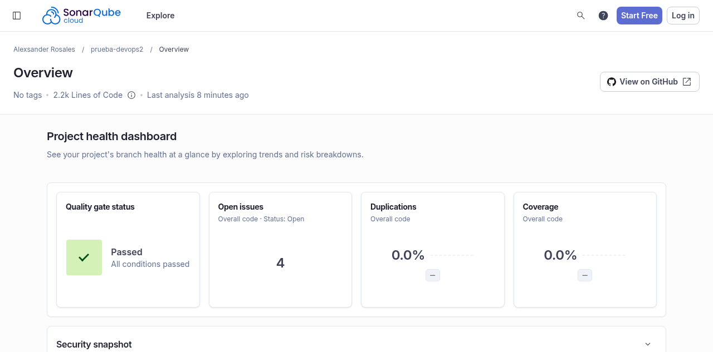
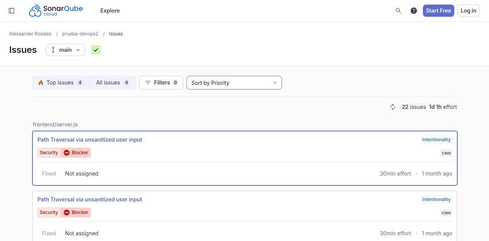
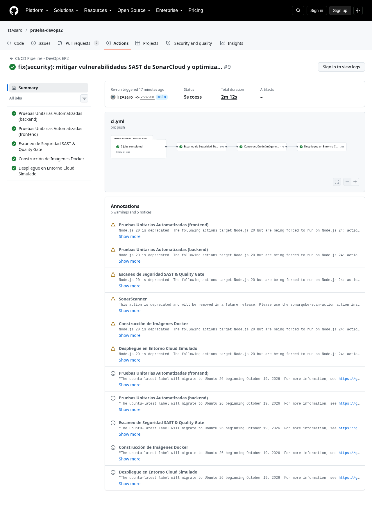

# 📸 Evidencias de SonarCloud SAST y Pipeline CI/CD — Evaluación Parcial N°2

> **Asignatura:** DOY0101 - Ingeniería DevOps  
> **Proyecto:** Plataforma de Preventas VI CITY  
> **Responsable de Seguridad (IE3):** Alexsander Rosales (Tech Lead & Security Core)  
> **Dashboard en Vivo:** [SonarCloud - prueba-devops2](https://sonarcloud.io/project/overview?id=iTzAsaro_prueba-devops2)

---

## 1. Quality Gate Aprobado en SonarCloud (`Passed`)
Evidencia del análisis estático de código en la nube certificando que el proyecto cumple todos los estándares de seguridad, mantenibilidad y calidad sin violaciones a las compuertas de entrega.

* **Estado de la compuerta:** `Quality Gate: Passed (All conditions passed)`
* **Líneas de código analizadas:** ~2.2k LoC
* **Duplicaciones de código:** `0.0%`
* **Vulnerabilidades y Hotspots activos:** `0`

---

## 2. Mitigación y Cierre de Vulnerabilidades SAST
Evidencia del historial de hallazgos en SonarCloud donde las vulnerabilidades críticas detectadas inicialmente (como la vulnerabilidad *BLOCKER* de Path Traversal en `frontend/server.js`) fueron remediadas en el código fuente y marcadas como resueltas (**Fixed**).

* **Vulnerabilidad remediada:** `Path Traversal via unsanitized user input` en `frontend/server.js` (Severidad: *BLOCKER* - Resuelto con sanitización de rutas `path.resolve`).
* **Vulnerabilidad remediada:** Generador de números pseudoaleatorios inseguro reemplazado por `crypto.randomInt` y `crypto.getRandomValues`.
* **Seguridad de Contenedores:** Eliminación de ejecución como root mediante `USER node` y Multi-Stage Builds.

---

## 3. Pipeline CI/CD en GitHub Actions (100% Verde)
Evidencia del flujo completo automatizado en GitHub Actions ejecutando las 4 fases del ciclo de vida en solo 2 minutos:

1. **Pruebas Unitarias Automatizadas:** Backend (10 tests) y Frontend (9 tests) pasando exitosamente.
2. **Escaneo de Seguridad SAST & Quality Gate:** Conexión con SonarCloud vía `SONAR_TOKEN`, verificación de dependencias y compuerta de bloqueo.
3. **Construcción de Imágenes Docker:** Empaquetado de imágenes multi-stage ligeras (45 MB cada una).
4. **Despliegue en Entorno Cloud Simulado:** Orquestación con Docker Compose, verificación de salud (`/api/health`) y registro inmutable de trazabilidad con `$GITHUB_SHA`.
